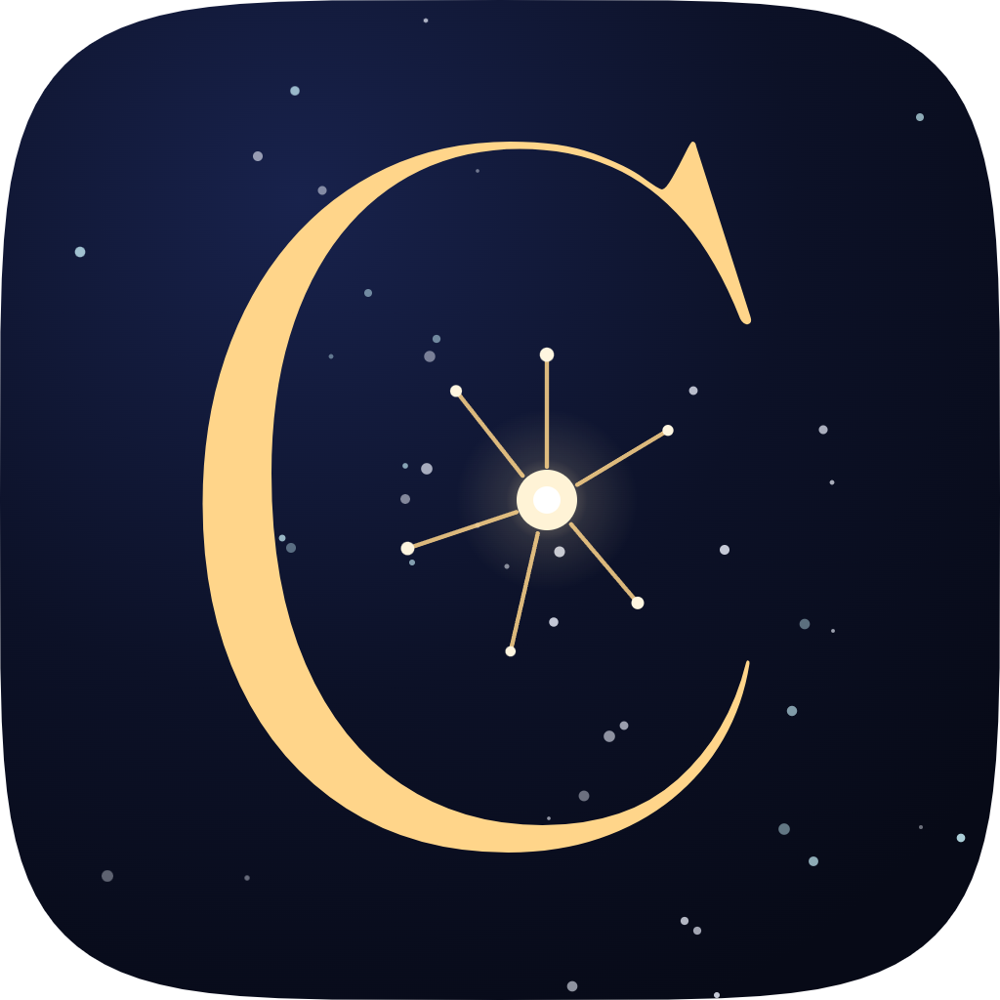
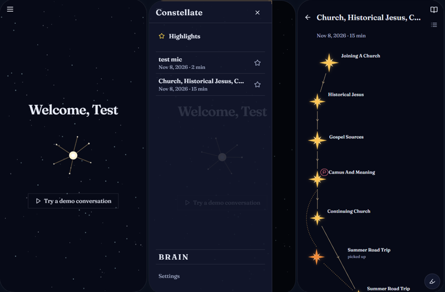

# Constellate 

Constellate is living map of your conversation that lets you remember how it was and help people like me remember what I was going to say in real-time.

Constellate is not a transcriber. Conversations are organic, and free flowing, they tell a story that cannot be captured by a simple summary, or set of meeting minutes. Constellate preserves the soul of a conversation, allowing its ebbs and flows to shine even in its recounting, letting us relive those special, deep conversations, and those beautifully mundane moments of banter.

As conversations are recorded, Constellate keeps track of the main points in nodes, and as the interaction moves to new topics it develops a network of nodes and connections in real-time that depicts the flow of the conversation.

These connections can also point back to previous topics as they are revisited or reemerge as a common theme, or indicate embers of thought that were mentioned but then forgotten and are yet to be fully explored. Giving deeper insights into your interactions.

The original goal of this project was to help busy people remember what they were going to say. The idea of connected nodes stemmed from retracing steps to aid recall. However, the idea’s impact is far more widespread, with applications as an interactive voice journal with post annotations, a way for ambitious people to store ideas in their original context with audio highlights, and as a way for conversations with those closest to you to never fade.



## Quick Start

If the Vercel deployment is running, click the link in the about section of the repository.

Sign in:

Email: demo@demo.com

Password: demo123

If the Vercel link is down Constellate can be run locally using:

```
pnpm dev:server
$env:VITE_USE_MOCKS='1'; pnpm dev:web
```
API keys for live transcription will expire shortly after the hackathon, so `pnpm dev:web` will not enable live transcription anymore; instead use the mocks (`VITE_USE_MOCKS='1'`) which have preloaded demo conversations.

Built using Claude Code.

Built for HackCamp 2026 (nwPlus, UBC).
