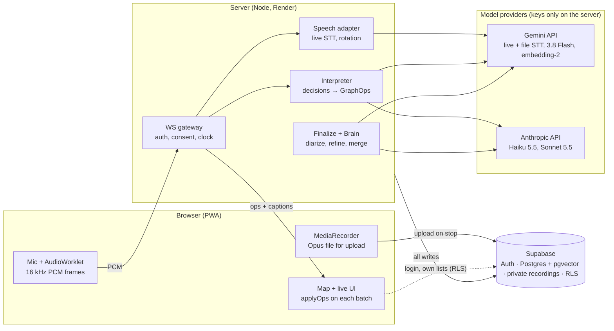

# Constellate — 12-Hour Implementation Plan

Written 2026-11-07. Exported from the team plan doc.

> **The repository is the source of truth for contracts.** Where this plan and `packages/shared`, `supabase/migrations` or `AGENTS.md` differ, the code wins. Known refinements made while implementing A0: live batches may not move layout, but `finalize` and `user` batches may; `match_concepts` takes an explicit `p_user` (the server calls it with the service role); `MODELS.interpreter.fast` holds the latency fallback; the demo fixture uses levels 1–2 only (level 0 is reserved for the macro anchor). **API budget (2026-11-07):** all reasoning runs on Claude; the free Gemini key is used only for live transcription and embeddings; test audio is supplied by the team; finalisation keeps the live transcript when file transcription is unavailable — see AGENTS.md → API budget.

## Summary and locked decisions

Build **Constellate** (working name): a phone-first web app that listens to a conversation, streams it to a TypeScript backend, and grows a live map of topics, branches, revisits and unexplored threads, saved to the cloud and merged across conversations into a "Brain". The plan is written so that five agents can build in parallel against one frozen contract package, with the speech-to-map interpreter isolated behind an evaluation harness so it can be iterated many times without touching the UI.

The core differentiator to protect in every decision: **the structure of the conversation is the product** (order, branches, returns, loose ends), not a summary.

| Decision | Choice | Why |
| --- | --- | --- |
| Delivery | React + Vite + TypeScript PWA, phone-first; shown in a phone frame on desktop, installable on phones | Your answers: web, PCs only. Agents can test it headlessly with Playwright. |
| Repo | One pnpm monorepo: `apps/web`, `apps/server`, `packages/shared`, `packages/interpreter`, `packages/brain`, `supabase/` | One source of truth for types; no cross-repo drift between agents. |
| Backend | Node 22 + Fastify + WebSocket gateway, deployed on Render | Holds API keys, owns the audio clock, runs the interpreter. |
| Data | Supabase: Auth, Postgres + pgvector, private Storage, Row Level Security | Real login and cloud persistence in under an hour. |
| Live speech-to-text | `gemini-3.5-transcribe-live` via the Gemini Live API, server-side | Uses the key you already have; streaming with interim and final transcripts. |
| Post-recording transcript | `gemini-3.5-transcribe` with diarization + word timestamps | Adds speaker labels and precise times the live model lacks. |
| Live topic interpreter | `gemini-3.8-flash` by default; `claude-haiku-5-5` as the challenger; the eval harness picks the winner by hour 4 | Fast structured JSON either way; provider is a config flag. |
| Final refinement + Brain merging | `claude-sonnet-5-5` | Stronger reasoning for one call per conversation. |
| Embeddings | `gemini-embedding-2` at 768 dimensions, L2-normalised | Revisit detection and Brain clustering in pgvector. |
| Map canvas | React Flow (`@xyflow/react`) with a custom deterministic layout | Custom node components, pan/pinch-zoom, minimap, keyboard focus. |
| Brain canvas | `react-force-graph-2d` | Physics clustering for the cross-conversation view. |
| Testing | Vitest, Playwright (mobile viewports + axe accessibility), an interpreter eval harness with golden transcripts, synthetic-audio STT tests, RLS tests | Gives the two human reviewers objective pass/fail gates. |

Optional upgrade, not required: Deepgram Nova-3 streaming adds live speaker labels; new accounts get $200 of credit with no card, and it plugs into the same speech adapter interface.

## Product scope

The demo must show one unbroken loop: **log in → record → watch topics appear, branch, loop back and leave loose ends → flag a moment → stop → reopen on another device → tap a node and hear that moment → generate the Brain across five conversations.** Everything below is ranked against that loop.

| Tier | Features | Rule |
| --- | --- | --- |
| Must (H0–H8) | Email/password auth; cloud-saved conversations; live mic capture; live captions; live topic nodes with forward, branch and revisit edges; pending / unexplored threads; tap node → preview → detail sheet with audio playback of that segment; pan, pinch-zoom, fit-all, jump-to-now; flag button + keyboard + media-key flag; library sidebar with folders and favourites; diary metadata (participants, place, reflection note) | Nothing in a lower tier starts until these work end to end on the replay path. |
| Should (H6–H10) | Post-recording refinement (diarized transcript, merged duplicates, detailed notes); highlighter for nodes and branches + Favourites tab; canvas sticky notes; "How did we get here?" path tracer; Park-a-thought; promise catcher; outline (list) view; semantic zoom (Broad / Balanced / Detailed); Brain v1 with drill-down sheet | Build in this order. |
| Could (H9–H11) | Recall cards; highlight-reel playback; "Last time with Sam" recap; low-stimulation mode; replay animation of a conversation growing | Only if Must and Should are green in CI. |
| Deferred | Native wrapper and hardware volume-button flag; live speaker identification; sharing maps between users; offline sync; automated reminders/notifications | Mention in the pitch as roadmap. |

Scope guardrails for agents: never build a feature that the replay path cannot exercise; never fake data in the UI (seed data must be produced by running real fixtures through the real pipeline); a feature without a test does not count as done.

## Architecture and stack

The browser captures audio and renders; the server owns the clock, the AI calls and all writes; Supabase owns identity and storage. API keys never reach the browser.



Data flow during a live recording:

1. The web app opens one `MediaStream`. An `AudioWorklet` converts it to 16 kHz mono 16-bit PCM and sends 100 ms binary frames over a WebSocket to the server. In parallel, `MediaRecorder` records the same stream to Opus/WebM for upload at the end.
2. The server authenticates the socket with the Supabase access token, creates the `conversations` row, and forwards PCM to the active speech adapter. The server's **audio clock** is bytes received ÷ 32 (16,000 samples × 2 bytes = 32 bytes per ms); every timestamp in the system is milliseconds on this clock.
3. Final transcript segments become `utterances` (ids `u1`, `u2`, …) and are echoed to the client as captions; interim text is echoed but never stored.
4. The interpreter buffers utterances, decides when to think (section on the interpreter), calls the LLM with structured output, validates the decision, and converts it to `GraphOp`s.
5. Ops are written to Postgres and pushed down the same socket. Client and server apply them with the **same pure reducer** from `packages/shared`, so the screen and the database cannot disagree.
6. On stop, the client uploads the WebM to Storage; the server runs the finalisation pass (diarized transcript → refinement → embeddings) and marks the conversation `ready`.

A **replay source** sits beside the microphone: the client can stream a WAV fixture as if it were the mic, or ask the server to replay a transcript fixture with its original timing (skipping speech-to-text). Every downstream component therefore runs identically in tests, in CI, and in the demo fallback.

### Libraries and services

| Layer | Choice | Notes |
| --- | --- | --- |
| Language / tooling | TypeScript 5 strict, Node 22, pnpm workspaces, ESLint + Prettier | One `tsconfig.base.json`; `pnpm -r typecheck` in CI |
| Web | React 19, Vite, React Router, Tailwind CSS, `vite-plugin-pwa`, Zustand (client state), TanStack Query (server data), `motion` (animation), `lucide-react` (icons), Inter font | Phone frame component on viewports wider than 600 px |
| Map | `@xyflow/react` (React Flow 12) | Custom node and edge types; layout computed by our own pure function, never by React Flow |
| Brain | `react-force-graph-2d` | Canvas rendering; custom glow drawn in `nodeCanvasObject` |
| Starfield | Hand-written canvas component | Static frame when `prefers-reduced-motion` is set |
| Server | Fastify 5, `@fastify/websocket`, `@fastify/cors`, `pino` logging, `zod` | Single process; one in-memory session object per live conversation |
| Speech | `@google/genai` Live API (`gemini-3.5-transcribe-live`), `gemini-3.5-transcribe` for files; optional `@deepgram/sdk` | Behind the `SpeechAdapter` interface |
| LLM | `@google/genai` (`gemini-3.8-flash`), `@anthropic-ai/sdk` (`claude-haiku-5-5`, `claude-sonnet-5-5`) | Both through the `LlmClient` interface with JSON-schema structured output (`output_config.format` on Claude) |
| Embeddings | `gemini-embedding-2`, `outputDimensionality: 768`, normalise to unit length | Stored as `vector(768)` with HNSW cosine indexes |
| Data | `@supabase/supabase-js` v2, Supabase CLI for migrations | Hosted project shared by the team (no local Docker needed on Windows) |
| Tests | Vitest, Testing Library, Playwright, `@axe-core/playwright`, `msw` for web mocks | See the testing section |
| Hosting | Web: Vercel (HTTPS needed for mic on phones). Server: Render web service (WebSockets + TLS) | Keep the Render instance warm before the demo |

## Repository layout and ownership

Each directory has exactly one owning workstream; an agent may read anything but writes only inside its own paths. This single rule prevents most merge conflicts.

```
constellate/
├── AGENTS.md            # rules every agent follows (Codex reads this)
├── CLAUDE.md, GEMINI.md # one line each: "Read AGENTS.md and docs/PLAN.md"
├── docs/
│   ├── PLAN.md          # this document, exported to Markdown
│   └── briefs/          # one brief per workstream (section: agent orchestration)
├── packages/
│   ├── shared/          # types, zod schemas, GraphOp reducer, layout, ws protocol, fixtures
│   │   └── fixtures/    # transcripts/*.json, graphs/*.json, ops/*.jsonl, audio/*.wav
│   ├── interpreter/     # topic engine, prompts, LLM clients, eval harness
│   └── brain/           # cross-conversation concept merging (pure logic + prompts)
├── apps/
│   ├── server/          # Fastify, ws gateway, speech adapters, persistence, finalize, REST
│   └── web/             # PWA
│       └── src/
│           ├── app/       # routes, shell, phone frame, auth screens, providers
│           ├── features/map/      # constellation canvas, inspector, playback, highlighter, notes, outline
│           ├── features/live/     # recording bar, captions, mic + replay sources, flag triggers
│           ├── features/library/  # sidebar, folders, favourites, diary sheet
│           ├── features/brain/    # Brain view and drill-down
│           └── ui/        # design tokens, primitives (Sheet, Button, Chip)
├── supabase/migrations/ # numbered SQL files
├── scripts/             # seed-demo.ts, render-tts.ts (A2)
├── e2e/                 # Playwright specs
└── .github/workflows/ci.yml
```

| Path | Owner | Others may |
| --- | --- | --- |
| `packages/shared` | A0 Foundation, then frozen (contract PRs only) | Read; propose additive changes by PR labelled `contract` |
| `supabase/migrations` | A1 Server | Request a migration in their PR description |
| `apps/server`, `packages/brain` | A1 Server | Read |
| `packages/interpreter`, `packages/shared/fixtures/transcripts`, `scripts/` | A2 Interpreter | Add fixtures by PR |
| `apps/web/src/features/map`, `features/live` | A3 Map UI | Read |
| `apps/web/src/app`, `features/library`, `features/brain`, `ui` | A4 Shell | A3 may add primitives to `ui/` via PR |
| `e2e/`, `.github/` | A5 QA | Every agent adds its own unit tests next to its code |

`AGENTS.md` must state, at minimum: the ownership table above; "never edit `packages/shared` outside a contract PR"; "never edit an applied migration — add a new one"; "run `pnpm verify` (lint + typecheck + unit tests) before every commit"; "never put API keys in `apps/web`"; "never invent model names — use the ids in `packages/shared/src/config.ts`"; "if the plan is ambiguous, write the question in the PR description and choose the simpler option".

## Shared contracts

`packages/shared` is written first, in hour 0–1, and frozen at the hour-1 checkpoint. Every type has a matching zod schema; every message crossing a process boundary is parsed with it. Field names below are camelCase in TypeScript and snake\_case in SQL; `packages/shared/src/db.ts` holds the two mapping functions.

### Domain types (`src/domain.ts`)

```ts
export type Ms = number;                       // ms on the server audio clock
export type NodeKind = 'topic' | 'pending' | 'parked';
// topic: discussed; pending: mentioned as "later" by a speaker; parked: typed by the user mid-chat
export type NodeStatus = 'provisional' | 'active' | 'closed' | 'unexplored' | 'resolved';
// provisional: not yet confirmed by the commit gate; resolved: pending/parked thread later discussed
export type Level = 0 | 1 | 2;                 // 0 theme · 1 subtopic · 2 specific idea

export interface TopicNode {
  id: string; conversationId: string;
  kind: NodeKind; status: NodeStatus; level: Level;
  label: string;            // 1–4 words, Title Case, no trailing punctuation
  summary: string;          // one sentence, ≤ 140 chars (hover / preview)
  details: string | null;   // markdown, filled by the finalisation pass
  parentId: string | null;  // conceptual parent (theme → subtopic → idea)
  threadId: string;         // shared by every occurrence of the same topic
  seq: number;              // creation order within the conversation, from 1
  startMs: Ms; endMs: Ms | null;
  mentionedAtMs: Ms | null; // pending/parked: when it was raised
  utteranceIds: string[];   // evidence, e.g. ['u41','u42']
  speakers: number[];       // diarized speaker indices, empty until finalised
  highlighted: boolean; createdBy: 'ai' | 'user';
  x: number; y: number;     // persisted layout position (see layout)
}
export type EdgeKind = 'flow' | 'revisit' | 'tether' | 'user';
// flow: the conversation moved A → B · revisit: new occurrence → earlier occurrence of the same thread
// tether: pending/parked node ↔ node where it was raised · user: drawn by the user
export interface TopicEdge { id: string; conversationId: string; sourceId: string; targetId: string; kind: EdgeKind; }
export interface Utterance { id: string; conversationId: string; speaker: number | null; startMs: Ms; endMs: Ms; text: string; }
export interface Flag { id: string; conversationId: string; atMs: Ms; nodeId: string | null; note: string | null; source: 'button' | 'key' | 'media' | 'tap'; }
export interface Commitment { id: string; conversationId: string; nodeId: string | null; text: string; speaker: number | null; atMs: Ms; done: boolean; }
export interface Annotation { id: string; conversationId: string; nodeId: string | null; text: string; x: number; y: number; }
export interface Conversation {
  id: string; userId: string; folderId: string | null;
  title: string; summary: string | null; macroAnchor: string | null;
  status: 'live' | 'processing' | 'ready' | 'failed';
  isSolo: boolean; isFavorite: boolean; location: string | null; reflection: string | null;
  startedAt: string; endedAt: string | null; durationMs: Ms | null; audioPath: string | null;
}
export interface GraphState { conversation: Conversation; nodes: Record<string, TopicNode>; edges: Record<string, TopicEdge>;
  activeNodeId: string | null; flags: Flag[]; commitments: Commitment[]; annotations: Annotation[]; lastSeq: number; }
```

### Graph operations and the reducer (`src/ops.ts`)

```ts
export type GraphOp =
  | { op: 'node.add'; node: TopicNode }
  | { op: 'node.update'; id: string; patch: Partial<Omit<TopicNode, 'id' | 'conversationId' | 'seq'>> }
  | { op: 'node.merge'; fromId: string; intoId: string }   // finalisation only; edges are rewired
  | { op: 'node.remove'; id: string }                       // provisional nodes only
  | { op: 'edge.add'; edge: TopicEdge }
  | { op: 'edge.remove'; id: string }
  | { op: 'active.set'; nodeId: string | null }
  | { op: 'flag.add'; flag: Flag }
  | { op: 'commitment.add'; commitment: Commitment }
  | { op: 'annotation.upsert'; annotation: Annotation }
  | { op: 'conversation.update'; patch: Partial<Omit<Conversation, 'id' | 'userId'>> };
export interface OpBatch { conversationId: string; seq: number; at: string; source: 'live' | 'finalize' | 'user'; ops: GraphOp[]; }
export function applyOps(state: GraphState, batch: OpBatch): GraphState;  // pure; throws OpError
```

Reducer invariants (each is a unit test): batches with `seq ≤ lastSeq` are ignored (idempotent replay); an edge whose endpoints do not exist is rejected; `node.remove` on a non-provisional node is rejected; `node.merge` rewires every edge, unions `utteranceIds`, and drops self-loops; layout `x/y` of existing nodes never changes except by an explicit `node.update` from the user.

### Layout (`src/layout.ts`)

`placeNode(state, node): {x, y}` is a pure, deterministic function, so a node keeps its position forever and the map stays stable for visual memory. Time flows **down** (portrait phone). Rule: `y = previous max y + 96`; lane `x = level × 140`, plus a deterministic ±18 px jitter from a hash of the node id for the constellation feel. A revisit node is placed in the lane of the occurrence it returns to. Pending and parked nodes sit in a right-hand gutter (`x = 3 × 140 + 40`) at the `y` of the node where they were raised. The finalisation pass may compact gaps but never reorders.

### WebSocket protocol (`src/ws.ts`)

```ts
// client → server (JSON text frames; audio as binary frames: PCM s16le, 16 kHz, mono, 100 ms = 3,200 bytes)
type ClientMsg =
  | { t: 'hello'; token: string; source: 'mic' | 'replay-transcript'; fixture?: string; conversationId?: string; consent: true; resumeAtMs?: number }  // resumeAtMs: reconnecting to an existing conversation
  | { t: 'flag'; atMs: number; source: Flag['source'] }
  | { t: 'park'; text: string; atMs: number }
  | { t: 'stop' } | { t: 'ping' };
// server → client
type ServerMsg =
  | { t: 'ready'; conversationId: string }
  | { t: 'caption'; text: string; final: boolean; utteranceId?: string; startMs: number }
  | { t: 'ops'; batch: OpBatch }
  | { t: 'status'; stage: 'listening' | 'thinking' | 'reconnecting-stt' | 'finalizing' }
  | { t: 'error'; code: 'auth' | 'stt' | 'llm' | 'db' | 'protocol'; message: string; fatal: boolean }
  | { t: 'stopped'; conversationId: string } | { t: 'pong' };
```

### Provider interfaces and config

```ts
export interface SpeechAdapter {           // apps/server/src/speech/*
  start(onSegment: (s: { text: string; final: boolean; startMs: number; endMs: number; speaker: number | null }) => void): Promise<void>;
  push(pcm: Buffer): void; stop(): Promise<void>;
}
export interface LlmClient {               // packages/interpreter/src/llm/*
  json<T>(args: { system: string; user: string; schema: object; model: string; timeoutMs: number }): Promise<{ data: T; ms: number; inTok: number; outTok: number }>;
}
// src/config.ts — the only place model ids live
export const MODELS = {
  sttLive: 'gemini-3.5-transcribe-live', sttFile: 'gemini-3.5-transcribe',
  interpreter: { gemini: 'gemini-3.8-flash', anthropic: 'claude-haiku-5-5', fast: 'gemini-3.5-flash-lite' },
  refine: 'claude-sonnet-5-5', brain: 'claude-sonnet-5-5',
  embed: 'gemini-embedding-2', embedDims: 768, tts: 'gemini-3.8-flash-tts',
} as const;
```

Environment variables (`.env.example` at root): `GEMINI_API_KEY`, `ANTHROPIC_API_KEY`, `SUPABASE_URL`, `SUPABASE_SERVICE_ROLE_KEY` (server only), `VITE_SUPABASE_URL`, `VITE_SUPABASE_ANON_KEY`, `VITE_SERVER_WS_URL`, `VITE_SERVER_HTTP_URL`, `STT_PROVIDER=gemini-live|deepgram`, `INTERPRETER_PROVIDER=gemini|anthropic`, optional `DEEPGRAM_API_KEY`, and `VITE_USE_MOCKS=1` to run the web app against recorded op streams with no server.

Fixtures in `packages/shared/fixtures` are part of the contract: `graphs/religion-demo.json` (a complete `GraphState` exercising every node kind, status and edge kind) lets the map UI be built before the interpreter exists, and `ops/religion-demo.jsonl` (timed `OpBatch`es) drives the mock live mode.

## Database, security and storage

One hosted Supabase project, one initial migration written by A0, every table carrying `user_id` so a single Row Level Security rule (`user_id = auth.uid()`) covers everything. The server writes with the service-role key but always sets `user_id` from the verified token, never from client input.

The key modelling choice: a **node is one occurrence of a topic in one conversation**; a **concept is a topic across conversations**. Three discussions of existentialism are three nodes and one concept.

```sql
-- supabase/migrations/0001_init.sql
create extension if not exists vector;

create table folders (id uuid primary key default gen_random_uuid(), user_id uuid not null references auth.users on delete cascade,
  name text not null, created_at timestamptz default now());

create table conversations (id uuid primary key default gen_random_uuid(), user_id uuid not null references auth.users on delete cascade,
  folder_id uuid references folders on delete set null, title text not null default 'Untitled conversation', summary text,
  macro_anchor text, status text not null default 'live' check (status in ('live','processing','ready','failed')),
  is_solo boolean not null default false, is_favorite boolean not null default false, location text, reflection text,
  started_at timestamptz not null default now(), ended_at timestamptz, duration_ms integer, audio_path text,
  last_seq integer not null default 0, brain_built_at timestamptz);

create table participants (id uuid primary key default gen_random_uuid(), user_id uuid not null, conversation_id uuid not null references conversations on delete cascade,
  display_name text not null, speaker_index smallint);

create table utterances (id text not null, user_id uuid not null, conversation_id uuid not null references conversations on delete cascade,
  speaker smallint, start_ms integer not null, end_ms integer not null, text text not null, primary key (conversation_id, id));

create table nodes (id uuid primary key, user_id uuid not null, conversation_id uuid not null references conversations on delete cascade,
  kind text not null check (kind in ('topic','pending','parked')),
  status text not null check (status in ('provisional','active','closed','unexplored','resolved')),
  level smallint not null check (level between 0 and 2), label text not null, summary text not null default '', details text,
  parent_id uuid references nodes on delete set null, thread_id uuid not null, seq integer not null,
  start_ms integer not null, end_ms integer, mentioned_at_ms integer, utterance_ids text[] not null default '{}',
  speakers smallint[] not null default '{}', highlighted boolean not null default false, created_by text not null default 'ai',
  x real not null, y real not null, concept_id uuid, embedding vector(768));

create table edges (id uuid primary key, user_id uuid not null, conversation_id uuid not null references conversations on delete cascade,
  source_id uuid not null references nodes on delete cascade, target_id uuid not null references nodes on delete cascade,
  kind text not null check (kind in ('flow','revisit','tether','user')));

create table flags (id uuid primary key default gen_random_uuid(), user_id uuid not null, conversation_id uuid not null references conversations on delete cascade,
  at_ms integer not null, node_id uuid references nodes on delete set null, note text, source text not null);
create table commitments (id uuid primary key default gen_random_uuid(), user_id uuid not null, conversation_id uuid not null references conversations on delete cascade,
  node_id uuid references nodes on delete set null, text text not null, speaker smallint, at_ms integer not null, done boolean not null default false);
create table annotations (id uuid primary key default gen_random_uuid(), user_id uuid not null, conversation_id uuid not null references conversations on delete cascade,
  node_id uuid references nodes on delete set null, text text not null, x real not null, y real not null, updated_at timestamptz default now());
create table highlights (id uuid primary key default gen_random_uuid(), user_id uuid not null, conversation_id uuid not null references conversations on delete cascade,
  name text, node_ids uuid[] not null, created_at timestamptz default now());
create table recall_cards (id uuid primary key default gen_random_uuid(), user_id uuid not null, conversation_id uuid not null references conversations on delete cascade,
  node_id uuid references nodes on delete cascade, prompt text not null, due_at timestamptz, last_result text);
create table op_log (conversation_id uuid not null references conversations on delete cascade, seq integer not null, user_id uuid not null,
  source text not null, ops jsonb not null, created_at timestamptz default now(), primary key (conversation_id, seq));

-- Brain
create table concepts (id uuid primary key default gen_random_uuid(), user_id uuid not null references auth.users on delete cascade,
  name text not null, description text, parent_concept_id uuid references concepts on delete set null,
  mention_count integer not null default 0, embedding vector(768));
create table concept_links (user_id uuid not null, source_id uuid not null references concepts on delete cascade,
  target_id uuid not null references concepts on delete cascade, relation text not null check (relation in ('broader','related','co_discussed')),
  weight real not null, primary key (source_id, target_id, relation));
alter table nodes add constraint nodes_concept_fk foreign key (concept_id) references concepts on delete set null;

create index on nodes using hnsw (embedding vector_cosine_ops);
create index on concepts using hnsw (embedding vector_cosine_ops);
create index on nodes (conversation_id, seq);

-- RLS: same policy on every table above
-- alter table <t> enable row level security;
-- create policy own on <t> for all using (user_id = auth.uid()) with check (user_id = auth.uid());

-- RPCs (security invoker)
-- match_nodes(p_conversation uuid, p_embedding vector, p_k int) → id, label, 1 - (embedding <=> p_embedding) as similarity
-- match_concepts(p_embedding vector, p_k int)                     → same over concepts for auth.uid()
```

Storage: one private bucket `recordings`, object path `{user_id}/{conversation_id}.webm`, with a policy allowing select/insert/delete only when `(storage.foldername(name))[1] = auth.uid()::text`. Playback uses a signed URL valid for one hour. Deleting a conversation deletes the object (server route) and cascades every row, including embeddings.

Auth: Supabase email + password (judges can sign up on their own phone in seconds); magic link is optional. Two fixed test accounts (`test-a@…`, `test-b@…`) exist for automated tests.

## Speech pipeline

Live transcription runs on `gemini-3.5-transcribe-live` from the server; a second, higher-quality pass with speaker labels runs on the saved file after the conversation ends. Speaker labels are a nice-to-have for the map, so their absence during the live phase is acceptable.

Facts that shape the design (from the current Gemini docs): the live model takes raw 16-bit PCM at 16 kHz in \~100 ms chunks and emits fast interim hypotheses plus a finalised transcript when a speaker pauses. Live sessions are capped at **10 minutes**, and live mode supports **neither diarization nor word timestamps**. The file model supports diarization (up to 8 speakers; 3 or more is experimental) and word timestamps, limited to 30 minutes of audio when those features are on.

### Capture (A3, `features/live`)

1. `getUserMedia({ audio: { echoCancellation: true, noiseSuppression: true, channelCount: 1 } })`.
2. An `AudioWorkletProcessor` downsamples to 16 kHz, converts to Int16, and posts 1,600-sample (100 ms) frames; the main thread sends them as binary WebSocket frames.
3. `MediaRecorder` (Opus/WebM, 1 s timeslice) records the same stream; on stop, the blob uploads to `recordings/{user}/{conversation}.webm` with the user's token.
4. A consent sheet precedes every recording ("Everyone in this conversation agrees to be recorded"); the `hello` message carries `consent: true` and the server refuses without it.
5. Replay sources for testing and demo safety: **WAV replay** decodes a fixture with `AudioContext` and feeds it through the same worklet at real-time speed, exercising speech-to-text end to end; **transcript replay** asks the server to emit fixture utterances on their original timing, skipping speech-to-text.

### Gateway (A1, `apps/server/src/live`)

- One `LiveSession` per socket: verifies the token with `supabase.auth.getUser(token)`, inserts the conversation, keeps the audio clock (`bytes ÷ 32` ms), and owns the speech adapter, the interpreter instance and an op sequence counter.
- **Session rotation** for the 10-minute cap: after 8 min 30 s, rotate at the first gap of 700 ms or more with no interim text (hard rotate at 9 min 45 s). Open the new upstream session first, switch PCM to it, then close the old one; send `status: reconnecting-stt` only if the switch takes longer than 1 s.
- **Timestamps**: the live model gives utterance-level results without word times, so `startMs` is the audio clock when the first interim text for that utterance arrived minus 300 ms, and `endMs` is the clock when the final arrived. That is accurate enough for seeking audio; the finalisation pass replaces it with word-accurate times.
- Backpressure: if the upstream socket stalls, buffer up to 5 s of PCM, then drop the oldest frames and log.
- Adapters: `GeminiLiveAdapter` (default), `DeepgramAdapter` (optional; streaming Nova-3 with live diarization), `TranscriptReplayAdapter`, and `FakeAdapter` for unit tests.

### Finalisation transcript (A1, `apps/server/src/finalize`)

After upload, call `gemini-3.5-transcribe` on the file with `diarization: true, wordTimestamp: true` (verbatim mode is required for both). Rebuild `utterances` from speaker turns, map each live utterance id to the new segments by time overlap so node evidence survives, and store speaker indices on nodes. If the call fails or the recording exceeds 30 minutes, keep the live transcript and mark speakers unknown.

### Quality checks for this stage

Synthetic test audio: A2 writes 6 short scripted conversations (two to three speakers, 2–4 min each, covering the interpreter scenarios). A script renders them to WAV with `gemini-3.8-flash-tts` (one voice per speaker, clips concatenated with `ffmpeg`, 0.3–1.2 s random gaps, optional cafe noise at −20 dB). A test streams each WAV through the gateway at real time and reports word error rate against the script and time-to-first-final-caption. Targets: WER under 15 % on clean audio, under 25 % with noise, first final caption within 2.5 s of the speaker pausing. Humans also record two real laptop-mic conversations early (hour 3) because synthetic voices are cleaner than people.

## Topic interpreter

The interpreter is a small state machine in `packages/interpreter` with no I/O of its own: it takes finalised utterances plus the current `GraphState` and returns `GraphOp`s. The LLM proposes a **decision** in a strict schema; deterministic code validates it, applies the commit gate and granularity controller, assigns ids, places nodes, and emits ops. The model never invents ids, coordinates or timestamps.

### When it thinks

Buffer finalised utterances and call the LLM when any of these is true, with at most one call in flight (new utterances queue for the next call):

- 20 s or more of new speech since the last call;
- a pause of 1.5 s or more after at least 8 s of new speech;
- a discourse marker in a new utterance: `/\b(anyway|back to|going back|speaking of|that reminds me|remind me|later|we should talk about|changing the subject|on another note|before I forget)\b/i` → call immediately.

Timeout 8 s; on timeout or a schema failure, retry once with the error message appended, then skip the window (its utterances roll into the next one). Captions keep flowing regardless.

### What it sees (context packing, ≈ 2–4k tokens)

1. **Macro anchor**: the session's broad theme (e.g. "Religion and Christian theology"), set by the model after about 90 s and only changed when the whole conversation has clearly moved.
2. **Outline**: every node as one line, `n7 | L1 | Resurrection Accounts | parent n3 | closed | 04:10–06:30`, plus the active node marked `ACTIVE`.
3. **Open threads**: pending and parked nodes with the quote that raised them.
4. **Revisit candidates**: the top 3 non-active topic nodes whose embedding has cosine similarity ≥ 0.75 with the embedding of the new window's text (via `match_nodes`).
5. **Rolling summary** of everything older than the last 10 utterances (≤ 600 characters, rewritten by the model each call).
6. **Recent utterances**: the last 10 for context, then the new window, each as `[u42 03:15 S?] text`.
7. **Granularity hint** (below).

### Decision schema (structured output)

```ts
type Decision = {
  action: 'continue' | 'new_topic' | 'revisit';
  continue?: { summary_update?: string };                 // refine the active node's one-liner
  new_topic?: { label: string; summary: string; level: 1 | 2;
    relation: 'child_of_active' | 'sibling_of_active' | 'child_of' | 'new_theme';
    parent_node_id?: string;                              // required when relation = child_of
    starts_at_utterance: string; explicit_shift: boolean };
  revisit?: { node_id: string; starts_at_utterance: string; label?: string; summary: string };
  intentions: { kind: 'deferred_topic' | 'promise'; label: string; quote_utterance: string }[];
  resolved_thread_ids: string[];                          // pending/parked nodes now actually being discussed
  macro_anchor?: string;
  rolling_summary: string;
};
```

### System prompt core (A2 refines it; keep it in `prompts/live.md`)

> You map the flow of a natural conversation between friends, not a meeting. Decide whether the new utterances continue the active topic, open a new topic, or return to an earlier one. A new topic is a change in the question being discussed, not a new sentence, example or joke. Levels: 1 = a subtopic of the macro anchor, 2 = a specific idea, story or claim inside a subtopic. Never create a node at the macro anchor's own level. Choose `revisit` only when speakers return to the same question as an earlier node, not merely a related one. Record an intention only when someone explicitly defers a topic ("remind me to tell you about soccer", "let's come back to that") or promises an action ("I'll send you the paper"). Labels: 1–4 words, concrete nouns ("Resurrection Historicity", not "Discussion About Faith"). Use only node ids and utterance ids that appear in the input.

Three short worked examples follow in the prompt file: a continuation, a child idea, and a revisit.

### Granularity controller (the answer to "how fine-grained?")

Granularity is **relative to the conversation**, not absolute. The macro anchor sets the floor (no node at its level), and a feedback loop on node density sets the zoom:

- Target density `TARGET_S_PER_NODE = 60` s of speech per committed node (tunable by the eval).
- If the active level-1 node has run more than 3 minutes with no children, the hint says: "The current subtopic has run long; split it into specific level-2 ideas where the question genuinely changes."
- If 3 or more nodes were created in the last 60 s without explicit shift markers, the hint says: "Be conservative: prefer continue."
- Otherwise the hint is empty.

The effect: a 45-minute conversation about religion gets Christianity as the anchor and Jesus, the resurrection and specific stories as nodes, while a ten-minute chat hopping between five subjects gets five level-1 nodes. The interface then offers semantic zoom over the stored hierarchy (Broad = level 1 only with child counts; Detailed = everything), so one stored graph serves every zoom.

### From decision to ops (deterministic code)

- **Commit gate**: a `new_topic` node is created `provisional` (rendered faint). It becomes `active` when the next call does not reverse it, when 15 s or two utterances have passed, or immediately if `explicit_shift` is true. If the next call says `continue` the previous node and the provisional one covers under 15 s, it is removed and its utterances fold back.
- Moving to a new node closes the previous one (`status: closed`, `endMs` set) and adds a `flow` edge previous → new.
- `revisit` creates a **new occurrence** with the earlier node's `threadId`, adds `flow` previous → new and `revisit` new → earlier. Chronology is never rewritten.
- `deferred_topic` intentions create a `pending` node plus a `tether` edge to the active node; `promise` intentions become `commitments`. `resolved_thread_ids` turns those nodes `resolved` and links them to the active node.
- Before accepting a new topic, compare its label embedding with open pending nodes (cosine ≥ 0.82) to auto-resolve threads the model missed.
- Reject and log any decision referencing unknown ids, a `starts_at_utterance` outside the window, or a label over 4 words (truncate rather than fail).
- Embed each new or updated node (`label + ". " + summary`) asynchronously; revisit candidates only need embeddings from earlier windows.
- At stop, every still-`pending` node becomes `unexplored`; the client shows them as "Open threads".

### Finalisation pass (after stop, one call to `claude-sonnet-5-5`)

Input: the diarized transcript with utterance ids, the live graph outline, flags, and commitments. Output (strict schema): renames, `merge` pairs for duplicates, `details` (3–5 sentences plus evidence utterance ids) for every topic node, corrected parents, status fixes for threads, extra commitments, a title (≤ 6 words), a one-sentence summary, and up to 3 recall prompts. It is converted to `OpBatch` with `source: 'finalize'`, preserving every id and never moving user annotations or highlights. If it fails, the live graph stands.

### Iteration loop for this component (expect 10+ rounds)

Each round: change a prompt or threshold → `pnpm eval` on all transcript fixtures with both providers → read the generated report (per-scenario pass/fail, metrics, latency, tokens, and a rendered outline of each produced graph) → commit only if the score does not drop. Keep every report in `packages/interpreter/eval/reports/` so humans can see the trajectory. The eval scenarios and metrics are in the testing section.

## The Brain

"Generate Brain" folds every finished conversation into a personal concept graph: one node per concept (for example *Existentialism*), sized by how often it comes up, linked by meaning and co-occurrence, each opening onto the exact moments it was discussed. It is built incrementally, so the button takes seconds after the first build.

Build (`packages/brain`, called by `POST /brain/rebuild`, owner A1):

1. Take conversations with `status = 'ready'` and `brain_built_at` null. For each topic node of level 1–2, fetch the top 5 concepts by cosine similarity ≥ 0.78 (`match_concepts`).
2. One `claude-sonnet-5-5` call per conversation, given the conversation's node labels and summaries plus their candidate concepts, returns for each node either `{ same_as: conceptId }` or `{ new_concept: { name, description, broader_than?: conceptId, narrower_than?: conceptId } }`. Similar is not the same: "Existentialism" and "Personal Philosophy" stay separate concepts linked as related; "Java" the language and "Java" the island never merge.
3. Write `nodes.concept_id`, create concepts (embedding = mean of their member node embeddings, normalised), bump `mention_count`, and add `broader` links.
4. Recompute links for the user: `co_discussed` weight = number of conversations containing both concepts ÷ conversations containing either; `related` from concept-embedding cosine ≥ 0.6 (top 4 per concept). Edge weight for layout: `w = 0.5·S + 0.3·C + 0.2·R` (semantic similarity, co-occurrence, explicit relation), a starting point to tune by eye.
5. Set `brain_built_at`.

View (`features/brain`, owner A4): `react-force-graph-2d` with link distance `40 + 160·(1 − w)` and node radius `6 + 3·√mention_count`; labels shown for the 15 largest concepts and on hover/focus. Tapping a concept dims everything except its neighbours and opens a bottom sheet: concept name, mention count, then one row per occurrence (date, conversation title, participants, the node's summary, a play button that seeks to `startMs` in that recording, and "Open in map"). A search box finds concepts by meaning (embed the query, `match_concepts`).

Demo data: `scripts/seed-demo.ts` runs five fixture conversations (philosophy, religion, fitness, career, a solo voice journal) through the real interpreter, finalisation and Brain build for the demo account, so the Brain is populated by the genuine pipeline rather than hand-made JSON.

## Interface and interaction design

The map is the product, so every screen is dark, quiet and mostly canvas; colour and motion are reserved for meaning (the active topic, a revisit, an open thread, a highlight). Single conversations read as constellations; the Brain reads as a galaxy.

### Design tokens (`apps/web/src/ui/tokens.css`)

| Token | Value | Use |
| --- | --- | --- |
| `--bg` | `#070A17` deep navy (not pure black) | App background; starfield only on Home and Brain at 15 % opacity |
| `--surface` | `rgba(22,28,52,0.72)` + 16 px backdrop blur | Sheets, sidebar, toolbar |
| `--text` / `--text-2` | `#E8ECF8` / `#A3ACC8` | Body / secondary (both ≥ 4.5 : 1 on `--bg`) |
| `--topic` | `#6FE3FF` cyan | Topic nodes, flow edges |
| `--revisit` | `#C79BFF` violet | Revisit arcs |
| `--thread` | `#FFC46B` amber | Pending, unexplored and parked threads |
| `--highlight` | `#FFD84D` gold | Highlighted nodes and branches |
| `--flag` | `#FF7A90` rose | Flag pins |
| Type | Inter 15 / 13 / 11.5; labels 600 weight | 44 px minimum touch targets |

### Visual language of the map (never colour alone)

| Element | Shape and line | Extra cue |
| --- | --- | --- |
| Topic node | Glowing circle, radius 18–30 px scaled by duration; label of 1–4 words beneath | Active node pulses slowly; provisional nodes at 40 % opacity |
| Level | Lane position (indent to the right per level) | Level-2 nodes slightly smaller |
| Flow edge (A → B) | Solid 1.5 px curve with arrowhead and slow particles moving forward | — |
| Revisit edge | Dashed arc swinging out to the left margin, arrowhead into the earlier node | "↺" badge on the new node |
| Pending / unexplored thread | Hollow dashed ring in the right gutter, tethered by a dotted line to where it was raised | Listed under "Open threads" |
| Parked thought | Same as pending, with a pencil glyph | Created by the user |
| Highlight | Gold ring + brighter edges along the highlighted branch | Appears in Favourites |
| Flag | Rose pin on the node covering that time | Also on the playback scrubber |
| User note | Small sticky card with a thin connector to its node (or free-floating) | Editable in place |

A one-tap legend sheet explains every symbol in words.

### Screens and routes

- `/login` — email + password, sign-up toggle, privacy note.
- `/` Home — starfield, "Welcome" (with the user's name), a large pulsing microphone orb, "Try a demo conversation" (transcript replay), and a hamburger opening the **library drawer**: Search, Favourites, folders, recent conversations with Solo / Group tags, and a gradient **Generate Brain** button pinned at the top.
- `/live/:id` — full-screen map; top bar with elapsed time, a red recording dot and status ("listening", "thinking…"); a one-line live caption strip; bottom bar with **Flag**, **Park a thought**, **Stop**. Auto-follows the newest node unless the user pans away; then a "Jump to now" chip appears.
- `/c/:id` — the saved map with a playback scrubber (flags and node boundaries marked on it; the node being heard glows), the floating toolbar (Fit, Detail: Broad / Balanced / Detailed, Highlighter, Note, Path tracer, Map ↔ Outline), and a Diary sheet (title, date, duration, participants, place, reflection prompt "What do you want to remember from this?", Open threads, Promises, Recall cards).
- `/brain` — the galaxy view and concept sheet.
- `/favorites` — highlighted nodes and branches, flagged moments, each playable.
- `/settings` — low-stimulation mode, text size, reduce motion, delete my data.

### Interactions

Tap a node → preview card (label, one-line summary, time range, play). Tap the card → detail sheet (details, evidence quotes, play segment with 1 s padding, add note, highlight, "How did we get here?"). Long-press → quick actions. Desktop hover shows the preview. Pinch or wheel to zoom, drag empty space to pan, double-tap empty space to fit. The path tracer lights the chain from the first node to the selected one and dims the rest. Highlighter mode: tap nodes or drag across a branch to paint it gold; saves a `highlights` row. Every edit is an optimistic `OpBatch` with `source: 'user'`, written through `POST /conversations/:id/ops`.

### Flag triggers that work on PCs and phones

The hardware volume button is not readable from a web page, so the flag listens to four inputs with one handler (`useFlagTrigger`): the on-screen button; a keyboard double-press of `F` or `Space` within 400 ms; **media keys** via `navigator.mediaSession.setActionHandler('nexttrack' | 'play' | 'pause', flag)` while a silent audio element keeps the session active, which also works with Bluetooth headphone buttons and laptop media keys; and double-tap anywhere in "Pocket mode" (screen dimmed to near-black). Each flag gives haptic feedback where `navigator.vibrate` exists and a brief toast.

### Accessibility (scored under Design)

- **Outline view**: the same graph as an indented, chronological list (`role="tree"`) with each node's status, time and relationships in words ("returns to Resurrection Accounts from 04:10"). Fully keyboard and screen-reader navigable; it is also the low-stimulation view.
- Edge types differ by dash pattern, arrow and badge, not only hue; palette checked for colour-vision deficiency.
- `prefers-reduced-motion` disables particles, pulses and the starfield animation; low-stimulation mode also hides the starfield and reduces glow.
- Visible focus rings; every control labelled; live captions double as a transcript for Deaf and hard-of-hearing participants.
- Text size setting (100–150 %) that the canvas labels respect.

### Phone simulation on PCs

`<PhoneFrame>` wraps the app at 390 × 844 with rounded corners when the viewport is wider than 600 px, and disappears on real phones. Developers also use Chrome DevTools device mode. Deployed builds are installable (PWA manifest, icons, `display: standalone`, `viewport-fit=cover`), so judges can open the Vercel URL on their own phones.

## Research review: ADHD, memory and conversation

The literature supports a specific claim: adults with ADHD have measurable difficulty holding information and intentions in mind during fast-moving activity, and external, cue-based supports fit that profile. It does **not** show that conversation maps improve outcomes; that is the hypothesis this product would test. Every ADHD feature below is opt-in, general-purpose, and never labels or diagnoses the user.

| Finding | Evidence | Design implication → feature |
| --- | --- | --- |
| Working memory deficits persist into adulthood | A meta-analysis of 38 adult studies found moderate deficits in both verbal and visuospatial working memory ([Alderson et al., 2013](https://pubmed.ncbi.nlm.nih.gov/23688211/)) | Holding "what we were talking about three tangents ago" is costly → **"How did we get here?" path tracer**; the live map as an always-visible external record |
| Thoughts in ADHD hop between topics | The mind-wandering account describes constant mental activity lacking topic stability ([Bozhilova et al., 2018](https://pubmed.ncbi.nlm.nih.gov/30036553/)) | Tangents are normal, not failures → the map treats branches as first-class, never as "off-topic" |
| Conversation itself is affected | A meta-analysis of 14 studies (5,772 participants) found markedly poorer pragmatic language in ADHD ([J. Atten. Disord., ahead of print](https://ifp.nyu.edu/?p=1666701)); reviews report weaker topic maintenance and turn-taking | Waiting to speak while holding a thought is hard → **Park a thought** (two words, one tap, becomes a thread you can return to) |
| Time-based intentions fail; event-cued ones mostly survive | In one paradigm, adults with ADHD showed a large time-based prospective-memory impairment but no event-based deficit ([Altgassen, Kretschmer & Kliegel, 2014](https://tud.qucosa.de/id/qucosa%3A35645)); real-life intentions were also executed less often ([Altgassen et al., 2019](https://link.springer.com/article/10.1007/s12402-018-0273-x)) | Anchor reminders to **events, not clock times** → "Before you go" banner listing open threads when Stop is pressed (while everyone is still together), and a **"Last time with Sam"** recap the next time a conversation with the same participant starts |
| If-then plans support intentions | A systematic and meta-analytic review examined implementation intentions for prospective memory ([Psychiatry Research 226(1), cited in](https://ouci.dntb.gov.ua/works/4YgNdmq9)) | **Promise catcher** phrases each commitment as "When \_\_\_, I will \_\_\_" and lets the user fill the cue |
| Long-term memory problems stem from encoding | Adult ADHD long-term memory deficits relate to acquisition rather than retrieval ([Skodzik et al., 2017](https://journals.sagepub.com/doi/10.1177/1087054713510561)) | Strengthen encoding right after the conversation → **reflection prompt** and optional **highlighting** at the end, while it is fresh |
| Retrieval practice works for students with ADHD | Students with and without ADHD benefited similarly from retrieval practice ([Knouse et al., 2020](https://eld.bl.uk/catalog/100104337305_0x000001); [Minear et al., 2023](https://www.ncbi.nlm.nih.gov/pmc/articles/PMC10397724/)) | **Recall cards**: "What did Alex argue about free will?" — answer first, then reveal the node and audio |
| Node-link maps aid retention, most when learners build them | A meta-analysis of 55 studies (5,818 participants) linked concept maps to better retention ([Nesbit & Adesope, 2006](https://sfu.ca/~jcnesbit/articles/nesbitadesope2006.htm)) | Keep users active in the map → highlight, annotate and draw their own links rather than only viewing |
| Offloading to the environment reduces load | Cognitive offloading is using physical action to reduce cognitive demand, guided by beliefs about one's own memory ([Risko & Gilbert, 2016](https://discovery.ucl.ac.uk/1508770/)) | The app is a trusted external store → Park a thought and Open threads let people stop rehearsing and listen |
| Reviewing personal recordings can cue recollection | Reviews of wearable-camera lifelogging in memory impairment suggest reviewing captured cues supports autobiographical recall, with limited evidence on recollection itself ([Dubourg et al., 2016](https://hal-univ-bourgogne.archives-ouvertes.fr/hal-01467185); [Silva et al., 2018](https://baes.uc.pt/bitstream/10316/47201/1/Silvaetal2015NRreviewpaper.pdf)) | A secondary audience: people with memory difficulties after brain injury. The diary + playback is a conversational lifelog; claims stay modest |

### Feature priority from this review

1. **Open threads + "Before you go" banner** (core feature, cheapest, strongest fit with the prospective-memory evidence).
2. **Park a thought** (one button and one node kind).
3. **Path tracer** (pure front-end over existing edges).
4. **Promise catcher** with if-then phrasing (one array in the finalisation schema).
5. **Recall cards** and **"Last time with…" recap** (Could tier).
6. **Low-stimulation mode + outline view** (also the accessibility story).

For the pitch, frame the evaluation honestly: a post-hackathon pilot would compare recall of conversation content and follow-through on stated intentions with and without the app.

## Agent orchestration

Six workstreams, one agent session each, split along the contract boundaries so that each can run and be tested alone against fixtures. Two humans each supervise three sessions and act as reviewers; neither human writes feature code unless an agent is stuck.

| Workstream | Agent (by fit; swap freely) | Human | Starts | Delivers |
| --- | --- | --- | --- | --- |
| A0 Foundation | Claude Code | H1 | H0 | Monorepo, `packages/shared` (types, zod, reducer, layout, ws protocol, fixtures), migration 0001, CI, AGENTS.md, stub apps that build |
| A1 Server | Codex | H1 | H1 | Gateway, auth, speech adapters, persistence, REST, finalisation orchestration, Brain build, Render deploy |
| A2 Interpreter | Claude Code | H1 | H1 | `packages/interpreter`, prompts, both LLM clients, eval harness + reports, transcript and synthetic-audio fixtures, `packages/brain` prompts |
| A3 Map + Live UI | Gemini CLI | H2 | H1 | Map canvas, node/edge components, inspector, playback, highlighter, notes, outline, live screen, audio capture, flag triggers |
| A4 Shell + Library + Brain UI | Codex | H2 | H1 | Routes, auth screens, phone frame, tokens, Home + starfield, library drawer, diary sheet, Favourites, Settings, Brain view, Vercel deploy |
| A5 QA + Review | Claude Code | H2 → H1 | H2 | Playwright E2E + axe, RLS tests, synthetic-audio STT test runner, PR reviews against this plan |

Why this fit: Claude for the judgement-heavy prompt and evaluation loop and for review; Codex for well-specified backend and app plumbing with tests; Gemini CLI for visual front-end work, where its large context window can hold the whole web app and the design spec at once.

### Rules of engagement

- **Branches and worktrees**: each agent works in its own git worktree on `ws/a1-server`, `ws/a2-interpreter`, …, merging to `main` through PRs at least every 90 minutes. Small PRs; rebase on `main` before opening.
- **Gate**: CI green (`pnpm verify` + E2E in mock mode) and one human approval. A5 reviews every PR against the plan and comments with file and line.
- **Contracts**: `packages/shared` is frozen at H1. A needed change is a separate PR labelled `contract`, additive only (new optional fields, new union members), approved by both humans; then every agent rebases.
- **Work against fakes first**: A3 and A4 build on `fixtures/graphs` and `VITE_USE_MOCKS=1` until the H5 checkpoint; A1 uses `FakeAdapter` and a stub interpreter; A2 never needs audio.
- **Definition of done** for any task: meets the brief, has tests, passes `pnpm verify`, has a short PR note with a screenshot or eval report, and states any deviation from this plan.
- **When stuck for 20 minutes**: the agent writes the blocker in its PR and moves to the next task; the human decides.

### Briefs (paste each into its agent with `docs/PLAN.md` attached)

**A0 Foundation (H0–H1, blocks everyone).** Create the pnpm monorepo exactly as in the layout section. Implement `packages/shared` from the contracts section verbatim: types, zod schemas, `applyOps` with the listed invariants as unit tests, `placeNode`, ws message schemas, `MODELS`, db mapping helpers. Write `fixtures/graphs/religion-demo.json` (≈ 14 nodes: 3 levels, 2 revisits, 2 pending of which 1 resolved, 1 parked, 2 flags, 1 note) and `fixtures/ops/religion-demo.jsonl` (the same graph as \~20 timed batches). Write `supabase/migrations/0001_init.sql` with RLS on every table and the two RPCs. Scaffold `apps/web` (Vite React TS, Tailwind, router, PhoneFrame placeholder) and `apps/server` (Fastify health route) so both build. Add `.github/workflows/ci.yml` (install, lint, typecheck, vitest, Playwright smoke in mock mode), `.env.example`, AGENTS.md, CLAUDE.md, GEMINI.md. Done when `pnpm verify` passes and both apps start.

**A1 Server.** Build `apps/server`: the WebSocket gateway and `LiveSession` per the speech section (auth, consent check, audio clock, session rotation, backpressure); `GeminiLiveAdapter`, `TranscriptReplayAdapter`, `FakeAdapter` (Deepgram only if time); persistence of utterances, op batches (`op_log` + materialised `nodes`/`edges`/…); REST: `GET /conversations/:id` (full `GraphState`), `POST /conversations/:id/ops` (user batches, validated by the reducer), `POST /conversations/:id/finalize`, `DELETE /conversations/:id` (rows + recording), `POST /brain/rebuild`, `GET /brain`. Integrate the interpreter through its public API only. Tests: protocol round trip with fakes, auth rejection, rotation with a 5 s cap, idempotent op replay, finalisation fallback. Deploy to Render.

**A2 Interpreter.** Build `packages/interpreter` per the interpreter section: trigger policy, context packer, granularity controller, decision schema, `GeminiClient` and `AnthropicClient` behind `LlmClient`, decision → ops translation with the commit gate, pending-thread logic, finalisation prompt and translator. Write 10 transcript fixtures with hand-labelled expectations (testing section) and the 6 TTS scripts. Build `pnpm eval` (live API) and `pnpm eval:replay` (recorded responses, deterministic, used in CI), producing a Markdown report. By H4 recommend the default provider with numbers. From H7, write `packages/brain` prompts and merge logic with A1.

**A3 Map + Live UI.** Build `features/map` on React Flow from the interface section: custom `TopicNode`, `ThreadNode`, `NoteNode` and `FlowEdge`, `RevisitEdge`, `TetherEdge` components; positions only from `placeNode`; semantic zoom; preview card, detail sheet, playback synced to the scrubber; highlighter; notes; path tracer; outline view; legend. Build `features/live`: mic + AudioWorklet + MediaRecorder, WAV replay source, ws client applying batches with `applyOps`, caption strip, recording bar, `useFlagTrigger`, Park a thought, consent sheet, "Before you go" banner on Stop. Work from fixtures and mock mode until H5. Add Playwright visual snapshots of the fixture map at three zoom levels.

**A4 Shell + Library + Brain UI.** Build `ui/` tokens and primitives, PhoneFrame, auth screens with Supabase, protected routes, Home with starfield and mic orb, the library drawer (folders CRUD, favourites, search by title, Solo / Group), the Diary sheet (participants, place, reflection, open threads, promises, recall cards), Favourites, Settings (reduce motion, low-stimulation, text size, delete my data), and the Brain view and concept sheet. Data via TanStack Query on Supabase for lists and on the server REST for graphs. Deploy to Vercel with the PWA manifest.

**A5 QA + Review.** From H2: Playwright specs on Pixel 7 and iPhone 14 viewports for the main loop in mock mode, then against the real stack from H6; axe checks on every route; keyboard-only path through record → stop → open node; RLS isolation test with two users; the synthetic-audio STT runner and WER report; review every PR against this plan and the AGENTS.md rules.

## Timeline and checkpoints

Foundation is the only serial step; after hour 1 all five workstreams run in parallel, meeting at five checkpoints where both humans merge, run the main loop and decide what to cut.

```mermaid
gantt
  title Live speech must reach the map by hour 5
  dateFormat H
  axisFormat %Hh
  section A0 Foundation
  Scaffold + contracts      :0, 1h
  section A1 Server
  Gateway + speech          :1, 4h
  Persist + finalize        :5, 3h
  Brain build               :8, 2h
  section A2 Interpreter
  Engine + eval             :1, 3h
  Prompt iterations         :4, 4h
  Brain merge               :8, 2h
  section A3 Map + Live UI
  Map on fixtures           :1, 4h
  Live + playback           :5, 3h
  Should tier               :8, 2h
  section A4 Shell + Brain UI
  Shell, auth, home         :1, 3h
  Library + diary           :4, 3h
  Brain view                :7, 3h
  section A5 QA + Review
  E2E (mock) + RLS          :2, 4h
  Real-stack E2E + STT      :6, 4h
  section Checkpoints
  H1 Contracts frozen       :milestone, 1, 0h
  H3 Replay to map          :milestone, 3, 0h
  H5 Live mic to nodes      :crit, milestone, 5, 0h
  H8 Feature complete       :milestone, 8, 0h
  H10 Code freeze           :milestone, 10, 0h
  section Whole team
  Demo prep                 :10, 2h
```



Each checkpoint passes only when the stated loop works on `main`:

1. **H1 Contracts frozen** — `pnpm verify` green; both apps start; fixtures load in a test.
2. **H3 Replay to map** — the web app in mock mode renders the fixture map with every node and edge kind; the server streams a transcript fixture through a stub interpreter to a test client; the first interpreter eval report exists.
3. **H5 Live mic to nodes** — a teammate talks into a laptop mic and real nodes appear on the deployed web app within about 25 s; conversation reload from the database works. If this fails, switch to the speech fallback immediately (risks section).
4. **H8 Feature complete** — the full demo loop from the product scope runs on the real stack; the interpreter release gate is met; finalisation produces details and titles.
5. **H10 Code freeze** — only bug fixes, copy, visual polish and tests after this point. Run `seed-demo.ts`, record the backup demo video (the Devpost submission allows up to 4 minutes), rehearse twice, warm the server.

## Testing and quality gates

Tests are layered so that each agent can prove its own piece in isolation and the humans can judge the whole with a handful of reports. CI runs everything deterministic on every PR; the live-API suites run on demand.

| Layer | Tool | What must pass | Runs |
| --- | --- | --- | --- |
| Contracts | Vitest | Every zod schema round-trips its fixture; reducer invariants; `placeNode` deterministic and never moves existing nodes | CI |
| Interpreter eval | `pnpm eval:replay` / `pnpm eval` | Scenario thresholds below | Replay in CI; live by A2 and humans |
| Speech | Synthetic-audio runner | WER < 15 % clean, < 25 % noisy; first final caption ≤ 2.5 s after a pause | On demand, at H3, H6, H10 |
| Server | Vitest + `ws` client | Protocol round trip with fakes; bad token rejected; consent required; rotation with a 5 s cap loses no utterance; replayed batches idempotent | CI |
| Database | Vitest + supabase-js with two test users | User B cannot read or write any of user A's rows or recordings | CI (against the hosted project) |
| Web units | Vitest + Testing Library | Node and edge components render each kind and status; flag trigger debounce; batch application | CI |
| End to end | Playwright, Pixel 7 + iPhone 14 viewports | Sign in → demo conversation → nodes appear → flag → stop → reopen → play a node → highlight persists → Brain renders | Mock mode in CI; real stack from H6 |
| Accessibility | `@axe-core/playwright` + keyboard spec | Zero serious or critical violations on every route; full keyboard path; reduced-motion snapshot has no animation | CI |
| Visual | Playwright screenshots of the fixture map | Diff reviewed by a human when it changes | CI |

### Interpreter scenarios (fixtures with hand-labelled expectations)

| # | Scenario | Pass condition |
| --- | --- | --- |
| 1 | Simple shift: sports → music | Exactly two level-1 nodes, flow edge between them, boundary within ±1 utterance |
| 2 | Drill-down: religion → Christianity → resurrection | Anchor set to the broad theme; nodes nest as parent → child |
| 3 | Return: philosophy → career → philosophy | Third segment is a new occurrence with a `revisit` edge to the first |
| 4 | Deferred and never discussed: "remind me to tell you about soccer" | One pending node that ends `unexplored` |
| 5 | Deferred then discussed later | Pending node ends `resolved` and links to the later node |
| 6 | Ten-second joke mid-topic | No committed node for it |
| 7 | Synonyms: "working out" / "going to the gym" | Treated as one thread (continue or revisit, not two topics) |
| 8 | Ambiguity: Java the language vs Java the island | Two different threads, no revisit edge |
| 9 | Promise: "I'll send you the paper tonight" | One commitment with that text |
| 10 | 20-minute single-theme deep dive | Between 12 and 30 nodes; no level-1 node lasting longer than 5 minutes without children |

Metrics in every report: boundary precision and recall (±1 utterance), revisit accuracy, thread precision and recall, nodes per minute versus target, median and 95th-percentile decision latency, tokens per minute. **Release gate for the interpreter at H8: at least 8 of 10 scenarios pass on the chosen provider, median latency under 3 s.**

### Human review checklist (the two judges of agent output)

- Does the PR match its brief and the contracts, with no edits outside its owned paths?
- Are new behaviours covered by tests that would fail without the change?
- Is the interpreter report better than or equal to the previous one?
- Does the screen still read clearly at a glance on a 390 px wide frame, in both reduced-motion and normal modes?
- Any key, token or recording reachable from the browser that should not be?

## Privacy and consent baseline

A device that listens to friends talking must earn trust visibly; these items are in scope for the hackathon, not deferred.

- A consent sheet before every recording, a persistent red recording indicator, and one-tap Stop. The server refuses audio without `consent: true`.
- Plain-language notice that speech is sent to Google (transcription, embeddings) and Anthropic (analysis) for processing. Check the current Gemini API terms for how content on unpaid tiers may be used, and use a billing-enabled key for any real recordings.
- Private by default: RLS on every table, private storage bucket, signed URLs that expire in an hour, no sharing features.
- Delete a conversation removes audio, transcript, graph, embeddings and Brain mentions; "Delete my data" removes everything for the account.
- No inference of sensitive attributes (health, religion, politics) about people; the Brain names topics discussed, not traits of participants.
- Testing uses only consenting teammates and synthetic voices; demo data is labelled as such.

## Risks and fallbacks

The biggest risk is live speech quality and latency; every fallback keeps the real pipeline and changes only the input, so the demo is never faked.

| Risk | Early signal | Fallback |
| --- | --- | --- |
| Live transcription too slow or inaccurate in the room | WER report at H3; first real laptop-mic test | Switch adapter to Deepgram (free credit, live speaker labels); or record first and run `gemini-3.5-transcribe` on the file, then animate the graph growing during playback, described honestly as post-recording |
| Interpreter fragments or over-merges | Eval nodes-per-minute and boundary scores | Tune `TARGET_S_PER_NODE` and the hints; fall back to Broad zoom as the default view |
| Decision latency > 3 s | Eval latency percentiles | Use `gemini-3.5-flash-lite` (MODELS.interpreter.fast) for live decisions and keep the stronger model for finalisation |
| 10-minute live session cap | Rotation unit test | Keep the stage demo under 8 minutes regardless |
| WebSocket drops on venue Wi-Fi | Status `reconnecting` | Client reconnects with the same `conversationId` and resumes; MediaRecorder keeps recording locally throughout |
| Render cold start | First request after idle | Hit `/health` five minutes before presenting |
| Agents conflict or drift from contracts | CI failure on `packages/shared` edits; A5 review | Ownership rules, frozen contracts, small PRs, checkpoint merges |
| Mic permission blocked | Browser prompt denied | Clear recovery screen; WAV replay source still demonstrates the pipeline |
| Run out of time | Checkpoint H8 missed | Cut the Could tier first, then the Brain search box, then notes; never cut the replay path or tests |

## Sources

APIs and models (checked November 2026):

- [Gemini API model deprecations and current model ids](https://ai.google.dev/gemini-api/docs/deprecations)
- [Gemini audio transcription (`gemini-3.5-transcribe`)](https://ai.google.dev/gemini-api/docs/generate-content/transcribe)
- [Gemini Live API transcription (`gemini-3.5-transcribe-live`)](https://ai.google.dev/gemini-api/docs/live-api/live-transcribe)
- [Claude structured outputs](https://platform.claude.com/docs/en/build-with-claude/structured-outputs)
- [Deepgram pricing and free credit](https://toolradar.com/tools/deepgram/pricing)
- [HackCamp 2026 on Devpost](https://hackcamp-2026.devpost.com/)

Research:

- [Alderson et al. (2013), ADHD and working memory in adults: a meta-analytic review, Neuropsychology](https://pubmed.ncbi.nlm.nih.gov/23688211/)
- [Bozhilova et al. (2018), Mind wandering perspective on ADHD, Neuroscience & Biobehavioral Reviews](https://pubmed.ncbi.nlm.nih.gov/30036553/)
- [Meta-analysis of pragmatic language in ADHD, Journal of Attention Disorders (ahead of print)](https://ifp.nyu.edu/?p=1666701)
- [Altgassen, Kretschmer & Kliegel (2014), Task dissociation in prospective memory in ADHD, Journal of Attention Disorders](https://tud.qucosa.de/id/qucosa%3A35645)
- [Altgassen et al. (2019), Everyday prospective memory and procrastination in adult ADHD, ADHD Attention Deficit and Hyperactivity Disorders](https://link.springer.com/article/10.1007/s12402-018-0273-x)
- [Implementation intention and prospective memory: systematic and meta-analytic review, Psychiatry Research 226(1) — as cited](https://ouci.dntb.gov.ua/works/4YgNdmq9)
- [Skodzik, Holling & Pedersen (2017), Long-term memory performance in adult ADHD: a meta-analysis, Journal of Attention Disorders](https://journals.sagepub.com/doi/10.1177/1087054713510561)
- [Knouse, Rawson & Dunlosky (2020), Retrieval practice for college students with ADHD, Learning and Instruction](https://eld.bl.uk/catalog/100104337305_0x000001)
- [Minear et al. (2023), Retrieval benefits students with ADHD, Frontiers in Psychology](https://www.ncbi.nlm.nih.gov/pmc/articles/PMC10397724/)
- [Nesbit & Adesope (2006), Learning with concept and knowledge maps: a meta-analysis, Review of Educational Research](https://sfu.ca/~jcnesbit/articles/nesbitadesope2006.htm)
- [Risko & Gilbert (2016), Cognitive offloading, Trends in Cognitive Sciences](https://discovery.ucl.ac.uk/1508770/)
- [Dubourg et al. (2016), SenseCam: a new tool for memory rehabilitation?, Revue Neurologique](https://hal-univ-bourgogne.archives-ouvertes.fr/hal-01467185)
- [Silva et al. (2018), A critical review of the effects of wearable cameras on memory, Neuropsychological Rehabilitation](https://baes.uc.pt/bitstream/10316/47201/1/Silvaetal2015NRreviewpaper.pdf)
